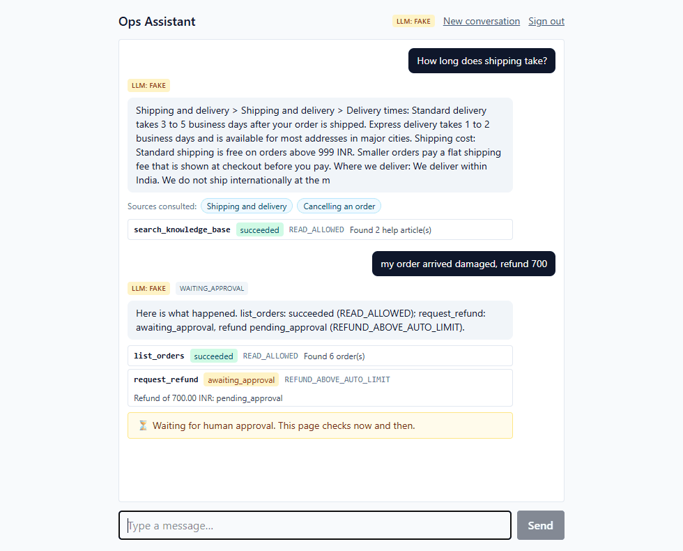
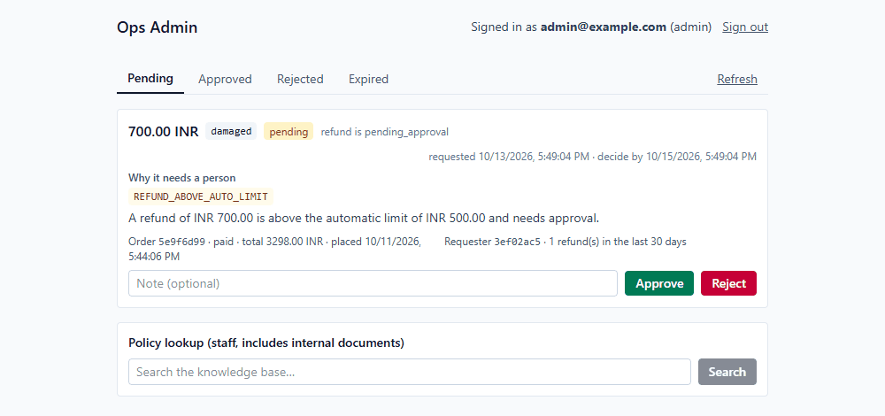
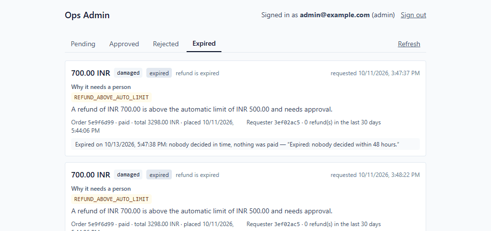
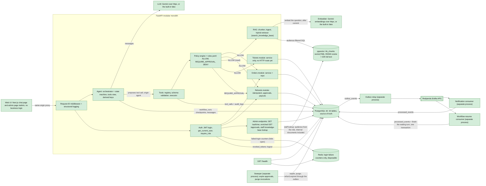

# Ops Platform

**A customer-support agent where the LLM only proposes and a deterministic backend decides: orders, refunds, tickets and FAQs, with human approval for the risky ones.**

[](backend/pyproject.toml)
[](backend/app/main.py)
[](frontend/package.json)

A customer chats ("my order arrived damaged, refund 700"), an LLM turns that into a **proposed tool call**, and a FastAPI backend validates it, checks permissions, runs it through a policy engine driven by `rules.yaml`, and logs every attempt. A refund above the automatic limit does not execute: it waits for a human on an admin page, and when the admin decides, the customer's waiting chat turn finishes by event, without a reload.

It is built to show how to put an LLM next to real money without trusting it: the safety lives in tested backend code, not in the prompt. It runs locally with a deterministic fake model by default (a real Gemini model is optional), the payment provider is simulated, and it is not deployed.

## What it looks like

*A customer asks a policy question (answered from the knowledge base, with its sources) and then for a 700 refund, which is over the 500 limit and waits for a human. The model badge says `FAKE`: this is the built-in scripted model.*



*The admin page shows why it needs a person, and by when. Approve and Reject ask for a confirmation first (it names the amount), then call the same endpoints any API client would; the page decides nothing.*



*Nobody decided in time: the sweeper expired the approval and its refund, nothing was paid, and the customer's page was told.*



## Why this is not a toy

- **The model proposes, the backend decides.** Every action, from a chat or an HTTP call, goes through one executor (`backend/app/tools/executor.py`): validate, authorize, policy, execute, log to `tool_calls` and `audit_logs`. The policy engine is pure functions over `rules.yaml` and answers ALLOW, REQUIRE_APPROVAL or DENY, always with a reason. Prompt-injection tests run a model that obeys every instruction and show the backend still refuses (`test_agent_injection.py`).
- **Refunds are idempotent in the database.** `UNIQUE (requested_by, idempotency_key)` plus a request hash; a test fires ten identical requests at once and gets exactly one refund and one payout. The payout call is made outside any database transaction.
- **Events go through a transactional outbox.** A state change and its event commit together; a separate relay publishes to Redpanda; a test fails if anything else can publish. A separate consumer finishes the customer's waiting turn on `refund.approved`, `rejected`, `completed`, `failed` or `expired`, de-duplicated in the same transaction as its effect.
- **Postgres is the source of truth.** Workflow checkpoints, the chat transcript, approvals and token revocations all live there. Redis holds only login-failure counters and may be lost without changing an outcome.
- **RAG that cannot leak.** Hybrid retrieval (vector plus full text) over 10 documents, with the audience filter inside the SQL: the assistant only ever reads `customer` documents, even when an administrator is chatting. Below an absolute relevance score it says "I'm not sure". The eval is published with its caveats (hybrid did not beat vector-only).
- **Hardened around the edges.** Failed logins are rate limited per email and IP (`429` with `Retry-After`, fails open if Redis is down); logout revokes the token in Postgres; pending approvals expire after 48 hours through a sweeper process and a late decision is refused; a crash returns a clean `500` that carries its request id; every page is served with a Content-Security-Policy and the usual security headers, and the API sets no CORS headers at all.
- **Tested by breaking it.** **1307 tests** (1276 fast, 31 against a real Redpanda), run against real Postgres built by the real Alembic migrations, plus **116 mutations in 9 lists**: deliberate defects (drop a lock, remove a role check, skip a commit) that the tests must catch. Run them with `python scripts/mutation/run.py`.
- **Honest records.** 49 logged design decisions, and a report per phase that says what was verified, by whom, and what was not.

## Architecture



Green is built; the full picture, every request flow and the data model are in [`docs/architecture.md`](docs/architecture.md).

## Try it in 5 minutes

You need Git, Docker with Compose v2, Python 3.12+ and **Node 24** (the frontend does not typecheck on Node 18), and free ports 5432, 6379, 9092, 8000 and 3000. No API key is needed: the defaults use the built-in fake model.

**1. Infrastructure and backend** (Windows PowerShell; macOS and Linux below):

```powershell
git clone https://github.com/lokakshworkspace-creator/ai-customer-ops-platform.git
cd ai-customer-ops-platform
Copy-Item .env.example .env
docker compose up -d postgres redis redpanda
docker compose ps                                       # wait until all three say "healthy"

cd backend
python -m venv .venv
.\.venv\Scripts\python -m pip install -e ".[dev]"
.\.venv\Scripts\python -m alembic upgrade head          # schema (head = 0007)
.\.venv\Scripts\python ..\scripts\seed.py               # admin, alice and bob, password123
.\.venv\Scripts\python ..\scripts\kb_ingest.py --apply  # index the help articles (fake embedder)
.\.venv\Scripts\python -m uvicorn app.main:app          # API on http://127.0.0.1:8000
```

**2. The web page** (second terminal):

```powershell
cd frontend
npm install
npm run dev                                             # http://127.0.0.1:3000
```

**3. Use it.** Open http://127.0.0.1:3000 and sign in as `alice@example.com` / `password123`.

1. Ask **"How long does shipping take?"**: the answer comes with a "Sources consulted" row.
2. Ask **"my order arrived damaged, refund 700"**: 700 is over the 500 automatic limit, so the page shows "Waiting for human approval" and nothing is paid.
3. Open http://127.0.0.1:3000/admin in another tab and sign in as `admin@example.com` / `password123`. The request is there with its reason; click **Approve**, then confirm with **Yes, approve 700.00 INR**.
4. Go back to Alice's tab: the final message appears within 15 seconds, without a reload.

**4. Optional: the event-driven parts.** Without these three processes everything above still works (the chat page's poll finishes the turn), but with them the turn finishes by event within moments, and expired approvals are swept. Each in its own terminal, from `backend/`:

```powershell
.\.venv\Scripts\python -m app.events.relay              # publishes outbox events to Redpanda
.\.venv\Scripts\python -m app.events.consumers.resume   # finishes waiting chat turns by event
.\.venv\Scripts\python -m app.jobs.sweeper              # expires approvals older than 48 hours
```

**macOS and Linux:** the same steps with `cp .env.example .env` and `.venv/bin/python` in place of `.\.venv\Scripts\python`. *Those paths are the standard equivalents and were not run (see Limitations).* To run the tests: `.\.venv\Scripts\python -m pytest` from `backend/` (Postgres and Redpanda up; `-m "not kafka"` needs Postgres and Redis only). More runnable demos, with their checks, are in the [guide](docs/guide.md).

## Tech stack

Python 3.12+ · FastAPI · SQLAlchemy 2 (async) · Alembic · Pydantic v2 · PostgreSQL 16 + pgvector · Redis · Redpanda (Kafka API, aiokafka) · httpx (Gemini REST for the chat model and the embeddings) · pytest · Next.js 16 · React 19 · TypeScript · Tailwind 4

## Project docs

| | |
|---|---|
| [Guide](docs/guide.md) | The API table, run books and demos for each phase, the security design, the full list of known limitations, the repo layout |
| [Architecture](docs/architecture.md) | Diagrams, every request flow, concurrency and locking, the data model |
| [Design decisions](docs/decisions.md) | 49 short decision records with their trade-offs |
| [Refunds API](docs/refunds-api.md) | The refund and approval endpoints, with the test that pins each behaviour |
| [Events](docs/events.md) | Event formats, delivery guarantees and failure handling |
| [Mutation testing](scripts/mutation/README.md) | How the 116 mutations work and how to add one |
| Phase reports | [0–1](docs/phase-0-1-report.md) · [2](docs/phase-2-report.md) · [3](docs/phase-3-report.md) · [4](docs/phase-4-report.md) · [5](docs/phase-5-report.md) · [6](docs/phase-6-report.md): what was built, measured, and not verified |

## Limitations

- **It runs on a fake model by default.** The built-in model is scripted and deliberately gullible (it exists to attack the backend with). A real Gemini model is optional (`LLM_PROVIDER=gemini` and a key in `.env`); on the free tier expect rate limits and several seconds per call. How a real model behaves in the chat was seen by the project owner in a browser, not by an automated test.
- **Not production-hardened, and not deployed.** The page runs on the Next.js dev server; there is no HTTPS or deployment setup (so no HSTS), and **no CI** (the tests run locally). The pages do get security headers and a Content-Security-Policy, but that policy has to allow inline scripts (`'unsafe-inline'`: Next.js writes them, and a nonce setup would need dynamic rendering of every page). The payment provider is a simulation.
- **The login limiter is per email and IP.** Behind the Next.js dev proxy, which adds no `X-Forwarded-For`, every browser looks like `127.0.0.1`, so there it is effectively per email, and a distributed attack from many IPs is not covered.
- **The background processes are separate and must be running.** Without the sweeper approvals never expire; nothing alerts when the relay, the consumer or the sweeper stops (an admin endpoint, `/api/v1/admin/pipeline`, shows it on demand).
- **Retrieval is small and its thresholds were tuned on the questions that measure them.** There are 10 sample documents, no answer-level evaluation and no re-ranker.
- **Only developed and tested on Windows.** The macOS and Linux commands above are the standard equivalents and were never run.

## License

[MIT](LICENSE), copyright 2026 Lokaksh K.
