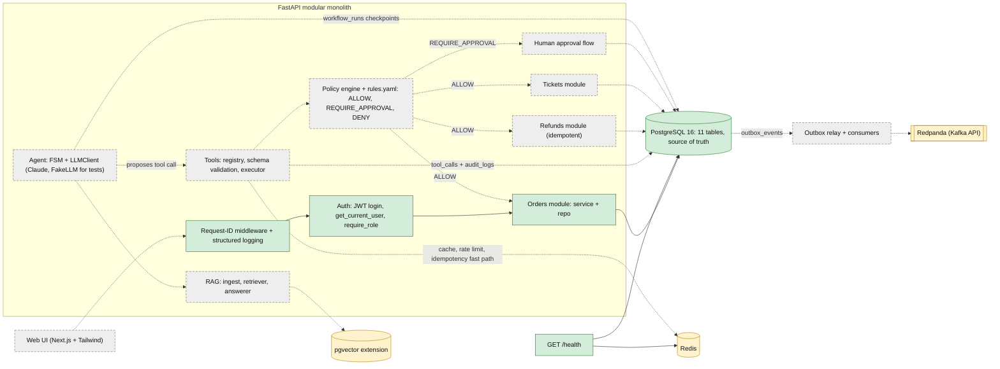
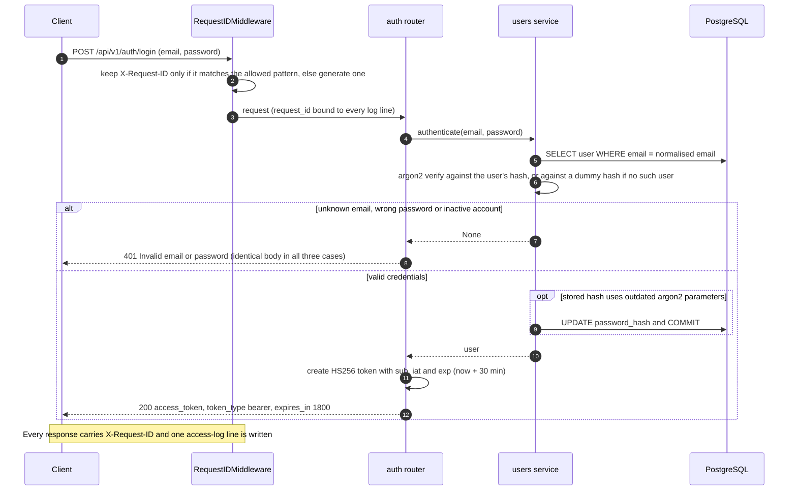
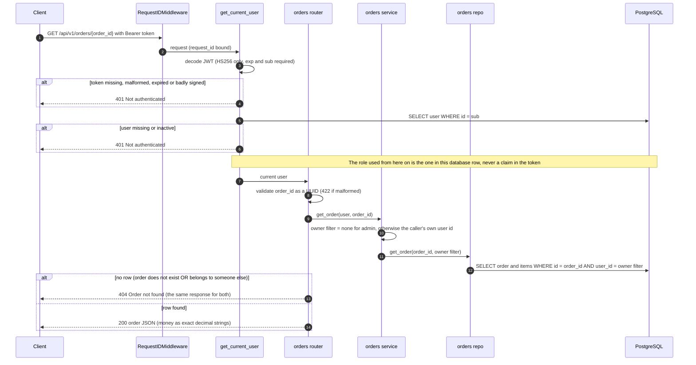
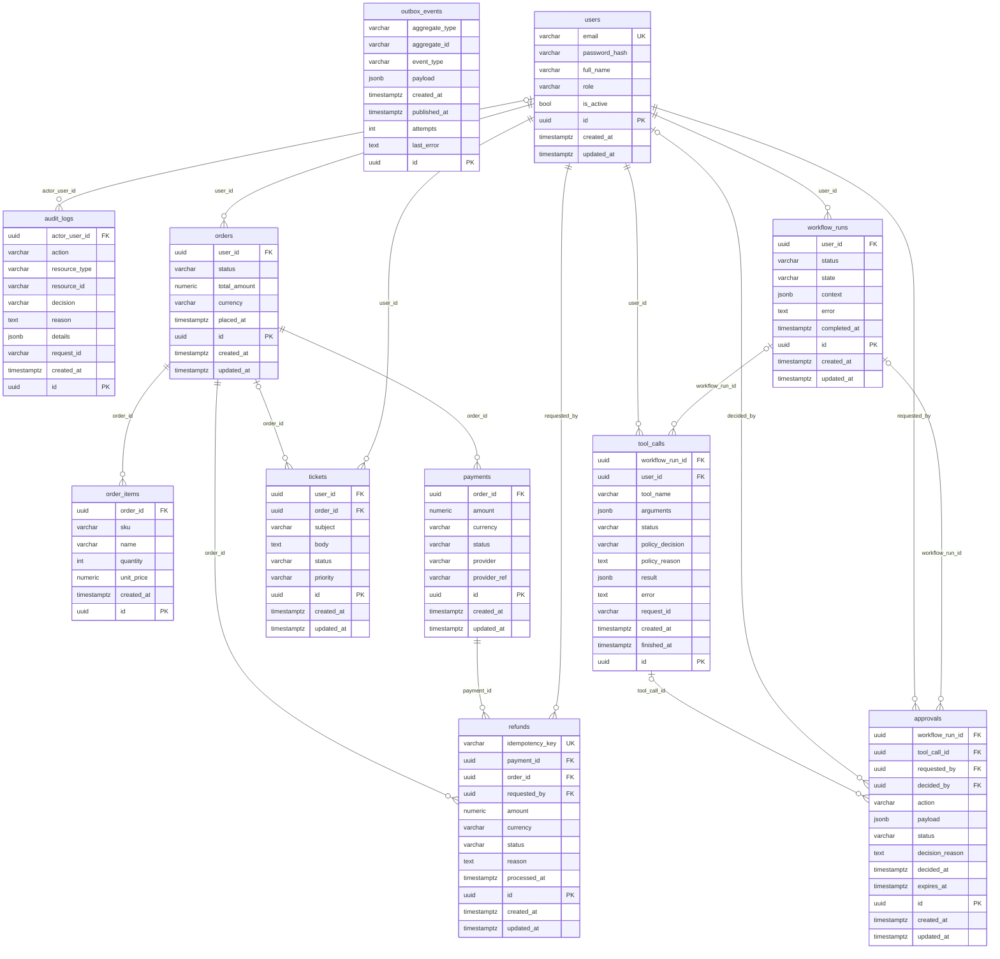

# Architecture

This document describes the system as designed (the target) and as built (Phases 0–1). Anything not yet built is marked **planned**. Diagrams use [Mermaid](https://mermaid.js.org/), which GitHub renders natively.

- [Target architecture](#target-architecture)
- [Request flows as implemented today](#request-flows-as-implemented-today)
- [Data model](#data-model)
- [Golden rules](#golden-rules)
- [Module layout](#module-layout)

## Target architecture

A **modular monolith**: one FastAPI process, with orders, refunds and tickets as modules that each have a service layer and a repository layer. Postgres is the source of truth. The LLM only ever *proposes* tool calls; every proposal goes through schema validation, authorisation and the policy engine before anything executes.



| Colour / line | Meaning |
|---|---|
| Green, solid | **Built** (Phases 0–1) |
| Amber | **Provisioned, not yet used** — it runs in `docker-compose.yml` or is enabled in the migration, but no application code depends on it. Redis is only pinged by `/health`; Redpanda has no clients; the `vector` extension is enabled but there are no vector columns. |
| Grey, dashed | **Planned** (Phases 2–7) |

## Request flows as implemented today

### Login: `POST /api/v1/auth/login`



### Reading one order: `GET /api/v1/orders/{order_id}`



Authentication always runs before path validation, so an unauthenticated caller gets `401` even for a malformed id. The list endpoint (`GET /api/v1/orders`) follows the same path with the owner filter applied to both the page query and the total count.

## Data model

Eleven tables, created by the single Alembic migration `0001`. Generated from the SQLAlchemy metadata (`Base.metadata`), so it matches the code. Types are simplified: `varchar` columns holding a fixed set of values (`status`, `role`, `decision`, …) are enforced by a named `CHECK` constraint; every money column is `numeric(12,2)` next to a `currency` column; all primary keys are UUIDs generated by the application.



Which tables application code uses today:

| Table | Today |
|---|---|
| `users` | Read by login and `get_current_user`; written by login (hash upgrade) and the seed |
| `orders`, `order_items` | Read by the orders API; written by the seed |
| `payments` | Written by the seed only |
| `refunds`, `tickets`, `workflow_runs`, `approvals`, `tool_calls`, `outbox_events`, `audit_logs` | Schema and constraints only — nothing reads or writes them yet (Phase 2+) |

The one constraint that already matters for a later phase: `refunds.idempotency_key` is `NOT NULL` with a `UNIQUE` constraint, tested at the database level.

## Golden rules

These come from `CLAUDE.md` and are never to be broken. The last column says how much of each exists today.

| # | Rule | Why | Today |
|---|---|---|---|
| 1 | The LLM proposes, the backend decides. The LLM never executes anything directly. | A model can be wrong or manipulated (prompt injection), so authority must live in deterministic code that can be tested and audited. | Planned (Phases 2–3); no LLM code exists yet |
| 2 | Every tool call passes schema validation → authorisation → policy engine → execution → `tool_calls` log. | One mandatory chokepoint means nothing runs unchecked and every attempt, allowed or denied, leaves a record. | Planned (Phase 2); `tool_calls` and `audit_logs` tables exist |
| 3 | Retrieved (RAG) text is data, never instructions. `rules.yaml` always beats any document. | Documents can contain injected instructions; business rules must come from one reviewed source. | Planned (Phases 2 and 4) |
| 4 | Postgres is the source of truth, including workflow state. Redis is disposable (cache, rate limit, idempotency fast path). | Losing Redis must never lose state or change an outcome, and a crashed workflow must be resumable from its last checkpoint. | Partly: Postgres holds all state and `workflow_runs` exists; Redis is provisioned but unused |
| 5 | The frontend contains zero business logic. | A single enforcement point in the backend can't be bypassed or spoofed by modifying a client. | No frontend yet; the API already enforces authorisation server-side |
| 6 | Refunds are idempotent: `Idempotency-Key` plus a database `UNIQUE` constraint. | Retries, double-clicks and repeated LLM proposals must never pay out twice; the database is the final arbiter even if Redis is wrong. | Constraint exists and is tested; refund logic is Phase 2 |
| 7 | Events go through a transactional outbox, never published directly from request handlers. | The state change and its event commit atomically, so a broker outage can neither lose an event nor emit one for a rolled-back change. | `outbox_events` table exists; relay and consumers are Phase 2 |

## Module layout

Taken from `git ls-files` for `backend/` and `scripts/` (so it is what exists now). `__init__.py` files and the `tests/` directory are omitted here; tests are listed below.

```text
├── backend/
│   ├── app/
│   │   ├── api/
│   │   │   ├── routers/
│   │   │   │   ├── auth.py
│   │   │   │   ├── health.py
│   │   │   │   └── orders.py
│   │   │   ├── deps.py
│   │   │   └── middleware.py
│   │   ├── core/
│   │   │   ├── config.py
│   │   │   ├── logging.py
│   │   │   └── security.py
│   │   ├── db/
│   │   │   ├── migrations/
│   │   │   │   ├── versions/
│   │   │   │   │   └── 0001_initial_schema.py
│   │   │   │   ├── README
│   │   │   │   ├── env.py
│   │   │   │   └── script.py.mako
│   │   │   ├── models/
│   │   │   │   ├── approval.py
│   │   │   │   ├── audit_log.py
│   │   │   │   ├── enums.py
│   │   │   │   ├── order.py
│   │   │   │   ├── outbox.py
│   │   │   │   ├── payment.py
│   │   │   │   ├── refund.py
│   │   │   │   ├── ticket.py
│   │   │   │   ├── tool_call.py
│   │   │   │   ├── user.py
│   │   │   │   └── workflow.py
│   │   │   ├── base.py
│   │   │   └── session.py
│   │   ├── modules/
│   │   │   ├── orders/
│   │   │   │   ├── repo.py
│   │   │   │   ├── schemas.py
│   │   │   │   └── service.py
│   │   │   └── users/
│   │   │       ├── repo.py
│   │   │       └── service.py
│   │   └── main.py
│   ├── alembic.ini
│   └── pyproject.toml
└── scripts/
    └── seed.py
```

| Path | Responsibility |
|---|---|
| `app/main.py` | App factory, lifespan (engine and Redis cleanup), middleware and router wiring |
| `app/api/middleware.py` | `RequestIDMiddleware`: validates or generates `X-Request-ID`, binds it to logs, writes the access log line |
| `app/api/deps.py` | `get_current_user`, `require_role`, `get_redis`, `get_session` |
| `app/api/routers/` | Thin HTTP layer: `health`, `auth`, `orders` |
| `app/core/config.py` | `pydantic-settings` configuration, including the production JWT-secret guard |
| `app/core/security.py` | argon2 hashing and the dummy hash, JWT create/decode (HS256 pinned) |
| `app/core/logging.py` | structlog configuration (console in dev, JSON in prod) |
| `app/db/base.py`, `session.py` | Declarative base, naming convention, UUID/timestamp mixins; async engine and session |
| `app/db/models/` | One file per aggregate, plus `enums.py` (VARCHAR + CHECK enums) |
| `app/db/migrations/` | Async Alembic environment and the `0001` migration (includes `CREATE EXTENSION vector`) |
| `app/modules/orders/`, `users/` | Service and repo layers (orders also has response schemas). Authorisation scoping lives in the orders repo/service |
| `scripts/seed.py` | Idempotent demo data (1 admin, 2 customers, 10 orders), refuses to run in prod |

Tests are in `backend/app/tests/`: `conftest.py` (real-Postgres fixtures), `factories.py`, `tokens.py` (JWT forging helpers), and `test_auth_deps.py`, `test_auth_login.py`, `test_config.py`, `test_health.py`, `test_orders_authz.py`, `test_request_id.py`, `test_schema.py`, `test_security.py`, `test_seed.py`.

**Planned but not created yet** (from the layout in `CLAUDE.md`): `app/agent/`, `app/policy/`, `app/tools/`, `app/events/`, `app/rag/`, `app/modules/refunds/`, `app/modules/tickets/`, and the Next.js frontend.
