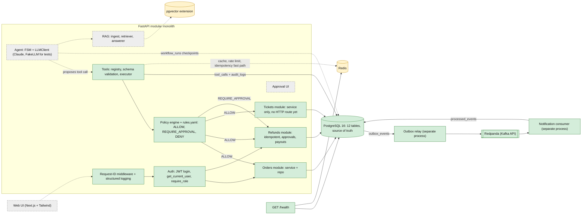
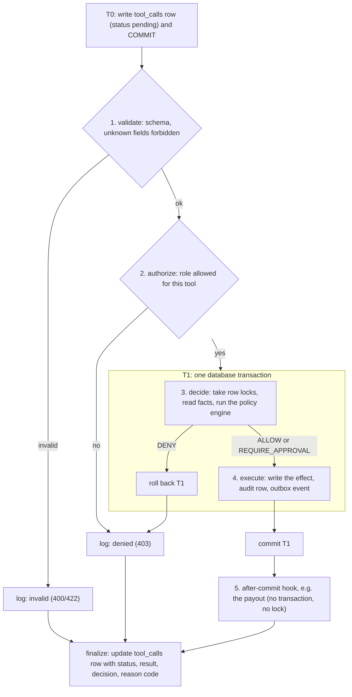
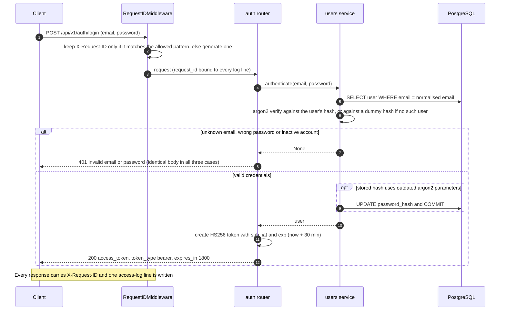
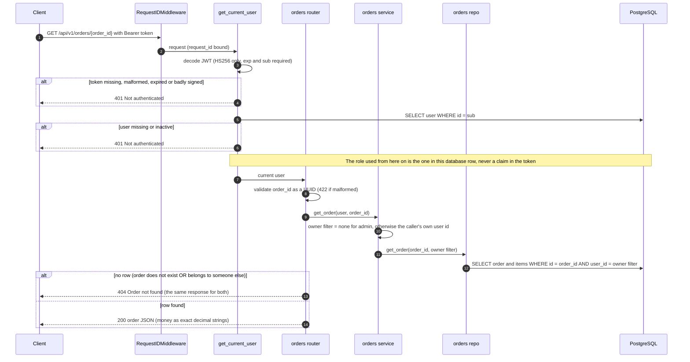
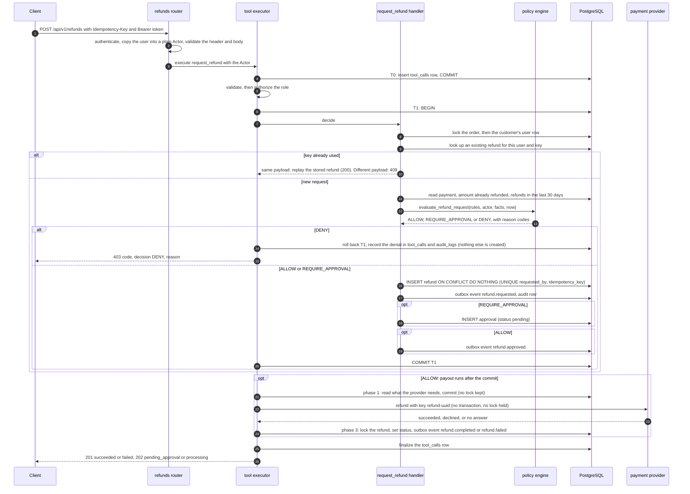
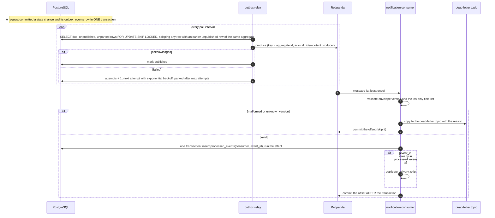
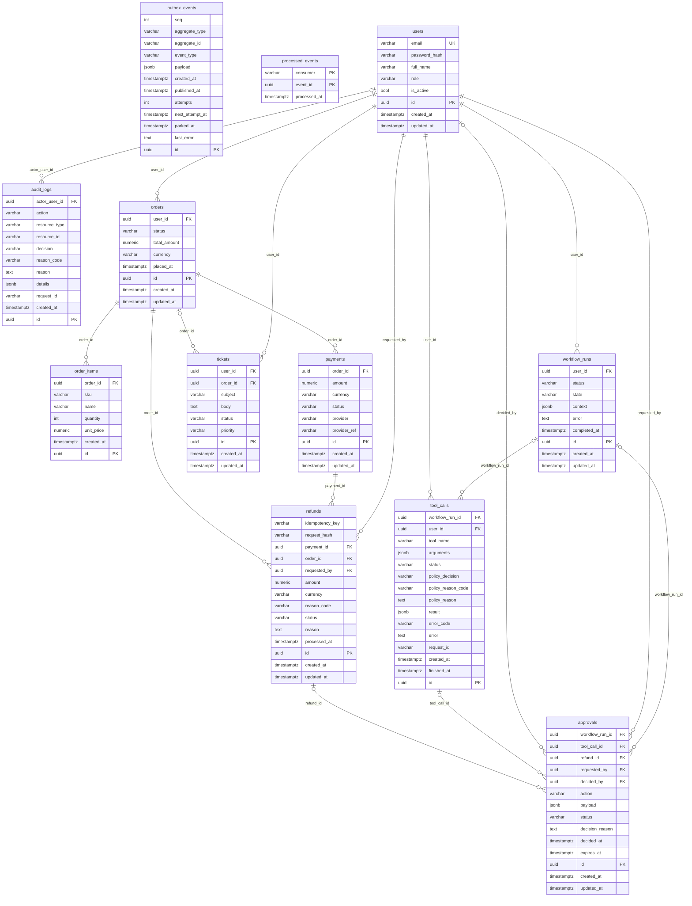

# Architecture

This document describes the system as designed (the target) and as built (Phases 0–2). Anything not yet built is marked **planned**. Diagrams use [Mermaid](https://mermaid.js.org/), which GitHub renders natively.

- [Target architecture](#target-architecture)
- [The tool pipeline](#the-tool-pipeline)
- [Request flows as implemented today](#request-flows-as-implemented-today)
- [Concurrency and locking](#concurrency-and-locking)
- [Data model](#data-model)
- [Golden rules](#golden-rules)
- [Module layout](#module-layout)

## Target architecture

A **modular monolith**: one FastAPI process, with orders, refunds and tickets as modules that each have a service layer and a repository layer. Postgres is the source of truth. The LLM only ever *proposes* tool calls; every proposal goes through schema validation, authorisation and the policy engine before anything executes. Two more processes run beside the API: the **outbox relay** and the **notification consumer**.



| Colour / line | Meaning |
|---|---|
| Green, solid | **Built** (Phases 0–2) |
| Amber | **Provisioned, not yet used** — it runs in `docker-compose.yml` or is enabled in the migration, but no application code depends on it. Redis is only pinged by `/health`; the `vector` extension is enabled but there are no vector columns. |
| Grey, dashed | **Planned** (Phases 3–7) |

The only caller of the tools today is the HTTP layer (the refund and approval endpoints). The dotted line from the agent shows where the Phase 3 caller will plug in: it will call the same executor with the same authenticated `Actor`.

## The tool pipeline

Golden rule 2 lives in one place, `app/tools/executor.py`. Every call, however it ends, leaves a `tool_calls` row and an `audit_logs` row.



* **Caller identity comes only from the authenticated `Actor`** (id and role, copied from the database user row by the router). Tool inputs forbid unknown fields, so a caller cannot smuggle a `user_id` or a `role` in.
* **Registered tools:** `get_order`, `list_orders`, `create_ticket`, `cancel_order`, `request_refund`, `approve_refund`, `reject_refund`. The two admin tools are never `agent_visible`, so the future model is never even shown them.
* **The policy engine is pure.** `app/policy/engine.py` takes frozen dataclasses (rules, actor, facts, a clock value) and returns a `PolicyResult` (decision plus reason codes). No database, no clock reads, no I/O. All thresholds come from `app/policy/rules.yaml`, which is validated on load so a malformed file fails fast instead of silently weakening a rule. Precedence: `DENY` beats `REQUIRE_APPROVAL` beats `ALLOW`.
* **Stored sizes are capped.** `tool_calls.arguments` (16 KiB) and `result` (32 KiB) have `CHECK` constraints as a backstop for the executor's truncation.

## Request flows as implemented today

### Login: `POST /api/v1/auth/login`



### Reading one order: `GET /api/v1/orders/{order_id}`



Authentication always runs before path validation, so an unauthenticated caller gets `401` even for a malformed id. The list endpoint (`GET /api/v1/orders`) follows the same path with the owner filter applied to both the page query and the total count.

### Requesting a refund: `POST /api/v1/refunds`

This is the Phase 2 path end to end for a refund within policy. The full response table is in [`refunds-api.md`](refunds-api.md).



`POST /api/v1/approvals/{id}/approve` is the same machinery: the executor runs `approve_refund`, whose handler takes the locks in the documented order, re-reads the approval and refund under them, asks the policy engine (an admin may not approve their own request: `SELF_APPROVAL` is a `DENY`), emits `refund.approved`, and the same payout hook runs after the commit.

### From database row to notification: the event pipeline



Details, failure handling and the event schema are in [`events.md`](events.md). `relay --once` and `consumers.notifications --once` have a hard overall deadline (default 120 s; exit code 3 with a message naming what they were waiting on) so a hang is a visible failure.

## Concurrency and locking

* **One lock order, defined in one file** (`app/db/locking.py`): **order → user → refund → approval**. Anything that takes more than one of these takes them in that order, so transactions can wait on each other but never in a cycle. The locks are `FOR NO KEY UPDATE`, which conflict with each other but not with the `FOR KEY SHARE` locks foreign-key checks take.
* **The order lock** serialises refunds and cancellations on one order, so "remaining refundable" cannot be over-committed. **The user lock** serialises the per-customer velocity count across their different orders.
* **Idempotency is decided by the database.** `UNIQUE(requested_by, idempotency_key)` plus `INSERT … ON CONFLICT DO NOTHING`: ten identical concurrent requests produce exactly one refund row and one provider ledger entry (a test fires ten at once). A request hash separates "same key, same payload" (replay) from "same key, different payload" (409).
* **No external call inside a transaction or under a lock.** The provider call is made between two short transactions, and its idempotency key is `refund-<refund uuid>`, never the caller's key. An answer that never arrives leaves the refund `processing`; `scripts/reconcile_refunds.py` re-checks those.
* **The relay is safe to run twice** (`SKIP LOCKED`), and the per-aggregate ordering check means a refund's events are published in order, even when a retry or a second relay is involved.

## Data model

Twelve tables, created by the Alembic migrations `0001` (the eleven Phase 1 tables) and `0002` (Phase 2: per-user refund idempotency and `request_hash`, new refund and tool-call states, outbox ordering and parking, the `processed_events` table). Generated from the SQLAlchemy metadata (`Base.metadata`), so it matches the code. Types are simplified: `varchar` columns holding a fixed set of values (`status`, `role`, `decision`, …) are enforced by a named `CHECK` constraint; every money column is `numeric(12,2)` next to a `currency` column; all primary keys are UUIDs generated by the application.



Which tables application code uses today:

| Table | Today |
|---|---|
| `users` | Read by login and `get_current_user`; written by login (hash upgrade) and the seed |
| `orders`, `order_items` | Read by the orders API and the policy facts; `cancel_order` updates orders; written by the seed |
| `payments` | Read by refunds and the reconcile job; written by the seed |
| `refunds`, `approvals` | Written and read by the refund and approval tools |
| `tool_calls`, `audit_logs` | Written by the executor for **every** call, including denied and invalid ones |
| `outbox_events` | Written in the same transaction as each refund or ticket change; read and updated by the relay and `outbox_admin.py` |
| `processed_events` | Written by the consumer (the de-duplication ledger) |
| `tickets` | Written by the `create_ticket` tool (no HTTP route yet) |
| `workflow_runs` | Schema only — nothing reads or writes it yet (Phase 3) |

Constraints that carry weight:

* `refunds`: `UNIQUE(requested_by, idempotency_key)`, `amount > 0`, `request_hash` (SHA-256 of the canonical payload).
* `outbox_events`: a unique identity column `seq` (strict publish order), `next_attempt_at`, `attempts`, `parked_at`, and partial indexes for "due and unpublished" and "earlier unpublished for this aggregate".
* `approvals`: at most one *pending* approval per refund (partial unique index).
* `tool_calls`: size caps on `arguments` and `result`.
* `processed_events`: primary key `(consumer, event_id)`, which makes a duplicate delivery a no-op.

## Golden rules

These come from `CLAUDE.md` and are never to be broken. The last column says how much of each exists today.

| # | Rule | Why | Today |
|---|---|---|---|
| 1 | The LLM proposes, the backend decides. The LLM never executes anything directly. | A model can be wrong or manipulated (prompt injection), so authority must live in deterministic code that can be tested and audited. | The deciding side is built (executor + policy engine); `agent_visible` keeps admin tools out of the model's reach. No LLM code exists yet (Phase 3) |
| 2 | Every tool call passes schema validation → authorisation → policy engine → execution → `tool_calls` log. | One mandatory chokepoint means nothing runs unchecked and every attempt, allowed or denied, leaves a record. | **Built** (`app/tools/executor.py`); tests check that denied, invalid and failed calls are logged |
| 3 | Retrieved (RAG) text is data, never instructions. `rules.yaml` always beats any document. | Documents can contain injected instructions; business rules must come from one reviewed source. | `rules.yaml` is the only source of thresholds. RAG is Phase 4 |
| 4 | Postgres is the source of truth, including workflow state. Redis is disposable (cache, rate limit, idempotency fast path). | Losing Redis must never lose state or change an outcome, and a crashed workflow must be resumable from its last checkpoint. | Postgres holds all state, and idempotency does not use Redis at all. `workflow_runs` is unused until Phase 3; Redis is provisioned but unused |
| 5 | The frontend contains zero business logic. | A single enforcement point in the backend can't be bypassed or spoofed by modifying a client. | No frontend yet; the API enforces authorisation and policy server-side |
| 6 | Refunds are idempotent: `Idempotency-Key` plus a database `UNIQUE` constraint. | Retries, double-clicks and repeated LLM proposals must never pay out twice; the database is the final arbiter even if Redis is wrong. | **Built and concurrency-tested** (10 simultaneous identical requests make one refund and one payout) |
| 7 | Events go through a transactional outbox, never published directly from request handlers. | The state change and its event commit atomically, so a broker outage can neither lose an event nor emit one for a rolled-back change. | **Built**: outbox writer, relay, consumer. A test (`test_no_direct_publish.py`) scans the source and fails if anything other than the event modules imports a Kafka client, builds an `OutboxEvent` by hand, or calls `add_event` from an unexpected place |

## Module layout

Taken from `git ls-files` for `backend/` and `scripts/` (so it is what exists now). `__init__.py` files and the `tests/` directory are omitted here; tests are described below.

```text
├── backend/
│   ├── app/
│   │   ├── api/
│   │   │   ├── routers/
│   │   │   │   ├── approvals.py
│   │   │   │   ├── auth.py
│   │   │   │   ├── health.py
│   │   │   │   ├── orders.py
│   │   │   │   └── refunds.py
│   │   │   ├── deps.py
│   │   │   ├── middleware.py
│   │   │   └── tool_responses.py
│   │   ├── core/
│   │   │   ├── config.py
│   │   │   ├── jsonutil.py
│   │   │   ├── logging.py
│   │   │   └── security.py
│   │   ├── db/
│   │   │   ├── migrations/
│   │   │   │   ├── versions/
│   │   │   │   │   ├── 0001_initial_schema.py
│   │   │   │   │   └── 0002_phase2_refunds_outbox_policy.py
│   │   │   │   ├── README
│   │   │   │   ├── env.py
│   │   │   │   └── script.py.mako
│   │   │   ├── models/
│   │   │   │   ├── approval.py
│   │   │   │   ├── audit_log.py
│   │   │   │   ├── enums.py
│   │   │   │   ├── order.py
│   │   │   │   ├── outbox.py
│   │   │   │   ├── payment.py
│   │   │   │   ├── processed_event.py
│   │   │   │   ├── refund.py
│   │   │   │   ├── ticket.py
│   │   │   │   ├── tool_call.py
│   │   │   │   ├── user.py
│   │   │   │   └── workflow.py
│   │   │   ├── base.py
│   │   │   ├── locking.py
│   │   │   └── session.py
│   │   ├── events/
│   │   │   ├── consumers/
│   │   │   │   ├── base.py
│   │   │   │   └── notifications.py
│   │   │   ├── admin.py
│   │   │   ├── envelope.py
│   │   │   ├── kafka.py
│   │   │   ├── outbox.py
│   │   │   ├── relay.py
│   │   │   ├── runtime.py
│   │   │   └── types.py
│   │   ├── modules/
│   │   │   ├── orders/
│   │   │   │   ├── repo.py
│   │   │   │   ├── schemas.py
│   │   │   │   └── service.py
│   │   │   ├── refunds/
│   │   │   │   ├── hashing.py
│   │   │   │   ├── payments.py
│   │   │   │   ├── reconcile.py
│   │   │   │   ├── repo.py
│   │   │   │   └── service.py
│   │   │   ├── tickets/
│   │   │   │   └── service.py
│   │   │   ├── users/
│   │   │   │   ├── repo.py
│   │   │   │   └── service.py
│   │   │   └── audit.py
│   │   ├── policy/
│   │   │   ├── engine.py
│   │   │   ├── rules.py
│   │   │   ├── rules.yaml
│   │   │   └── types.py
│   │   ├── tools/
│   │   │   ├── handlers/
│   │   │   │   ├── base.py
│   │   │   │   ├── orders.py
│   │   │   │   ├── refunds.py
│   │   │   │   └── tickets.py
│   │   │   ├── context.py
│   │   │   ├── default.py
│   │   │   ├── executor.py
│   │   │   ├── registry.py
│   │   │   └── schemas.py
│   │   └── main.py
│   ├── alembic.ini
│   └── pyproject.toml
└── scripts/
    ├── mutation/
    │   ├── README.md
    │   ├── cleanup.json
    │   ├── commit2.json
    │   ├── commit3.json
    │   ├── commit4.json
    │   ├── commit5.json
    │   └── run.py
    ├── demo_cleanup.py
    ├── demo_phase2.py
    ├── kafka_smoke.py
    ├── outbox_admin.py
    ├── reconcile_refunds.py
    └── seed.py
```

| Path | Responsibility |
|---|---|
| `app/main.py` | App factory, lifespan (engine and Redis cleanup), middleware and router wiring |
| `app/api/middleware.py` | `RequestIDMiddleware`: validates or generates `X-Request-ID`, binds it to logs, writes the access log line |
| `app/api/deps.py` | `get_current_user`, `require_role`, `get_redis`, `get_session` |
| `app/api/routers/` | Thin HTTP layer: `health`, `auth`, `orders`, `refunds`, `approvals` |
| `app/api/tool_responses.py` | Maps a tool outcome (status, decision, reason code) onto the HTTP response |
| `app/core/config.py` | `pydantic-settings` configuration, the production JWT-secret guard, `configured_app_env()` / `dev_only_refusal()` for the dev-only scripts |
| `app/core/security.py`, `jsonutil.py`, `logging.py` | argon2 and JWT (HS256 pinned); JSON-safe/capped serialisation; structlog |
| `app/db/base.py`, `session.py`, `locking.py` | Declarative base and mixins; async engine and session; the row-lock helpers and **the** lock order |
| `app/db/models/` | One file per aggregate, plus `enums.py` (VARCHAR + CHECK enums) |
| `app/db/migrations/` | Async Alembic environment; `0001` initial schema (includes `CREATE EXTENSION vector`), `0002` Phase 2 schema |
| `app/policy/` | `engine.py` (pure decision functions), `rules.py` (loading and validation), `types.py`, `rules.yaml` (all thresholds) |
| `app/tools/` | `registry.py` (specs, roles, `agent_visible`), `schemas.py` (inputs), `executor.py` (the pipeline), `context.py`, `default.py` (the default registry), `handlers/` (orders, tickets, refunds) |
| `app/modules/orders/`, `users/`, `tickets/` | Service and repo layers. Authorisation scoping lives in the orders repo/service |
| `app/modules/refunds/` | `service.py` (facts, events), `repo.py` (idempotent insert), `hashing.py` (canonical request hash), `payments.py` (provider interface, simulated provider, payout phases), `reconcile.py` |
| `app/modules/audit.py` | Writes `audit_logs` rows |
| `app/events/` | `outbox.py` (writer, field allow-list), `envelope.py` (version 1), `relay.py`, `consumers/` (base class + notifications), `kafka.py` (producer and consumer wrappers), `runtime.py` (signals, `--once` deadline), `admin.py` (unpark), `types.py` |
| `scripts/` | `seed.py`; `demo_phase2.py` and `demo_cleanup.py` (dev only); `reconcile_refunds.py`, `outbox_admin.py`, `kafka_smoke.py`; `mutation/` (runner and five lists, 56 mutations) |

Tests are in `backend/app/tests/`: **643 tests** (`pytest --collect-only -q`) in 35 test files, plus shared helpers (`conftest.py` with the real-Postgres fixtures and the `committed_db` fixture for concurrency tests, `factories.py`, `tokens.py`, `policy_helpers.py`, `event_helpers.py`, `worlds.py` for building a customer/admin/order scenario). 28 of them use the real Redpanda and carry the `kafka` marker; `pytest -m "not kafka"` runs the other 615 with Postgres only.

**Planned but not created yet** (from the layout in `CLAUDE.md`): `app/agent/`, `app/rag/`, and the Next.js frontend.
