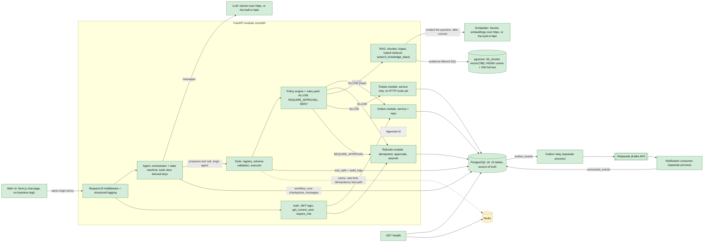
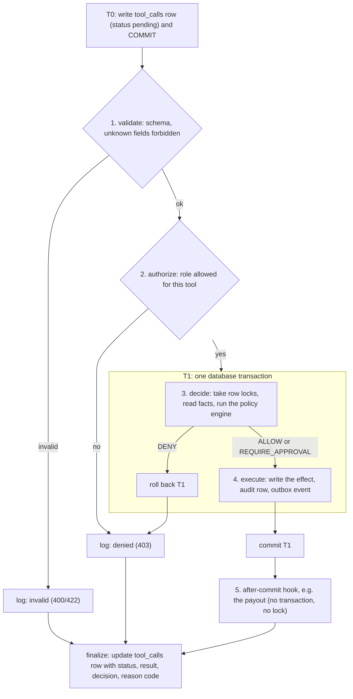
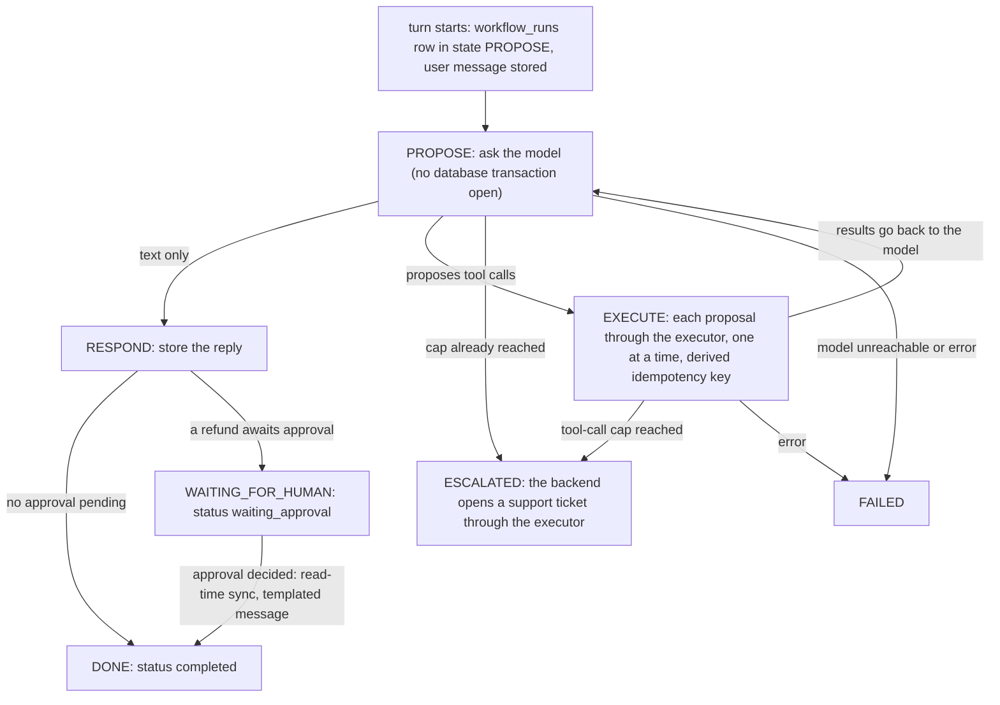
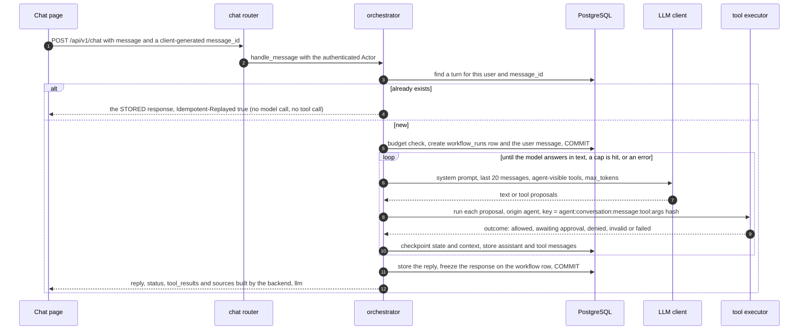
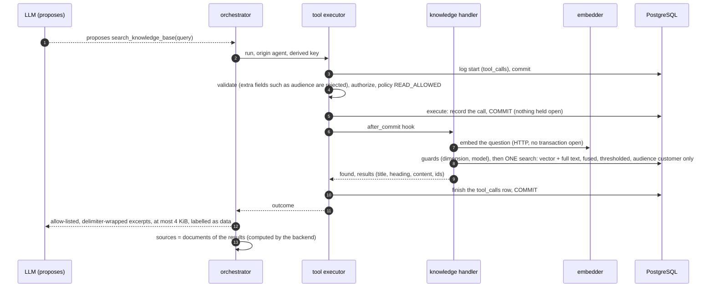
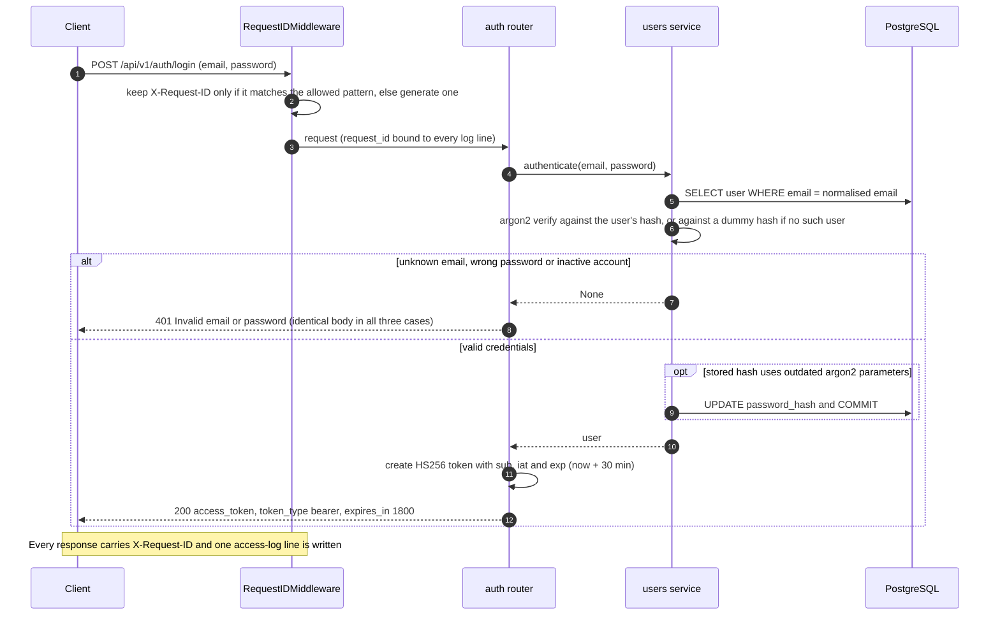
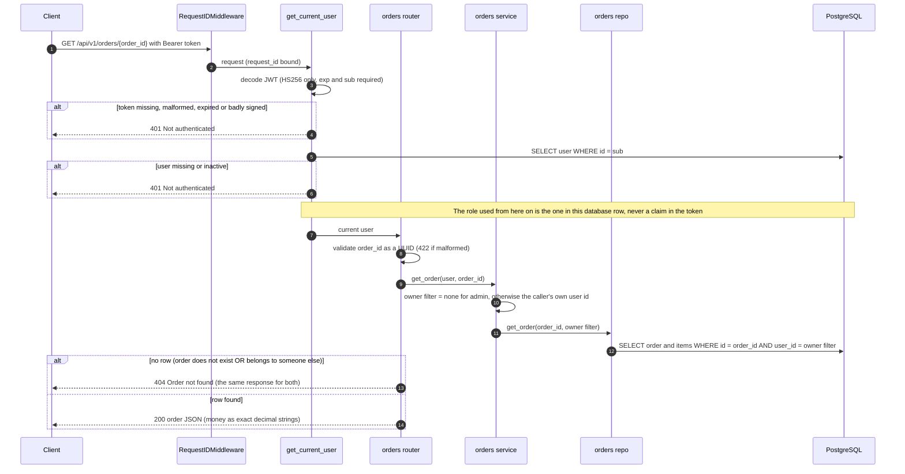
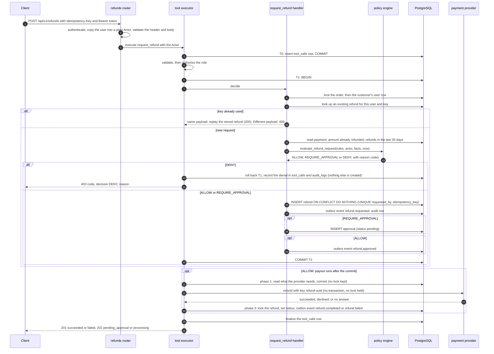
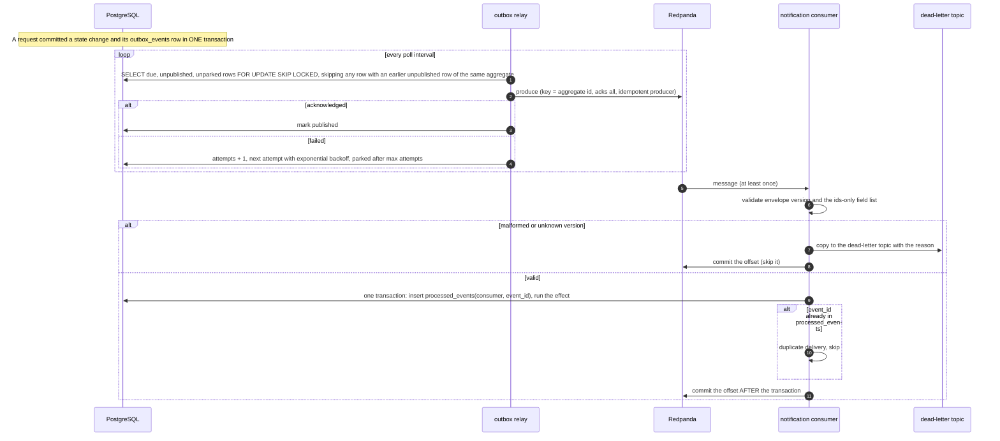
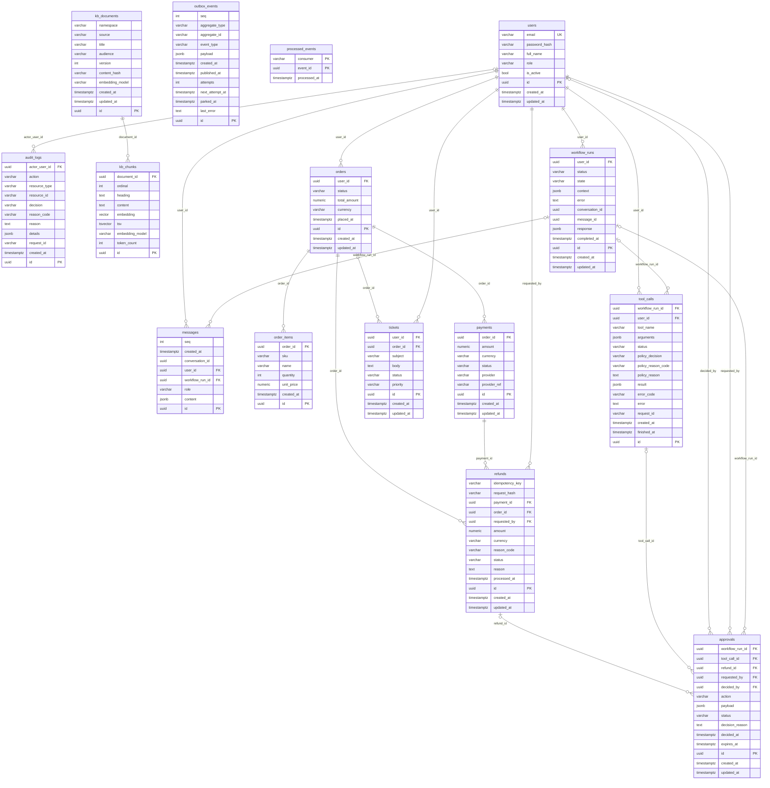

# Architecture

This document describes the system as designed (the target) and as built (Phases 0–4). Anything not yet built is marked **planned**. Diagrams use [Mermaid](https://mermaid.js.org/), which GitHub renders natively.

- [Target architecture](#target-architecture)
- [The tool pipeline](#the-tool-pipeline)
- [The agent](#the-agent)
- [Retrieval: the knowledge base](#retrieval-the-knowledge-base)
- [Request flows as implemented today](#request-flows-as-implemented-today)
- [Concurrency and locking](#concurrency-and-locking)
- [Data model](#data-model)
- [Golden rules](#golden-rules)
- [Module layout](#module-layout)

## Target architecture

A **modular monolith**: one FastAPI process, with orders, refunds and tickets as modules that each have a service layer and a repository layer. Postgres is the source of truth. The LLM only ever *proposes* tool calls; every proposal goes through schema validation, authorisation and the policy engine before anything executes. Two more processes run beside the API: the **outbox relay** and the **notification consumer**.



| Colour / line | Meaning |
|---|---|
| Green, solid | **Built** (Phases 0–4) |
| Amber | **Provisioned, not yet used** — it runs in `docker-compose.yml` or is enabled in the migration, but no application code depends on it. Redis is only pinged by `/health`. |
| Grey, dashed | **Planned** (Phases 5–7) |

The tools have two callers: the HTTP layer (the refund and approval endpoints) and the agent. Both call the same executor with the authenticated `Actor`; the agent's calls carry `origin="agent"`, which narrows what it may run (next section). The knowledge-base search is one more tool behind that executor: it is read-only, and it is not reachable over HTTP, only through the agent and the tests.

## The tool pipeline

Golden rule 2 lives in one place, `app/tools/executor.py`. Every call, however it ends, leaves a `tool_calls` row and an `audit_logs` row.



* **Caller identity comes only from the authenticated `Actor`** (id and role, copied from the database user row by the router). Tool inputs forbid unknown fields, so a caller cannot smuggle a `user_id` or a `role` in.
* **Registered tools:** `get_order`, `list_orders`, `create_ticket`, `cancel_order`, `request_refund`, `approve_refund`, `reject_refund`. The two admin tools are never `agent_visible`, so the future model is never even shown them.
* **The policy engine is pure.** `app/policy/engine.py` takes frozen dataclasses (rules, actor, facts, a clock value) and returns a `PolicyResult` (decision plus reason codes). No database, no clock reads, no I/O. All thresholds come from `app/policy/rules.yaml`, which is validated on load so a malformed file fails fast instead of silently weakening a rule. Precedence: `DENY` beats `REQUIRE_APPROVAL` beats `ALLOW`.
* **Stored sizes are capped.** `tool_calls.arguments` (16 KiB) and `result` (32 KiB) have `CHECK` constraints as a backstop for the executor's truncation.

## The agent

A chat message is one **turn**: one tool loop, one `workflow_runs` row. The model never executes anything: it proposes, and every proposal is handed to the executor (`origin="agent"`). State and context are checkpointed in Postgres on every transition (golden rule 4); `app/agent/fsm.py` defines the legal transitions and tests enumerate all of them.



There is no separate classification call: the model either answers in text or proposes tools. Policy and FAQ questions are answered by one more tool, `search_knowledge_base` (see [Retrieval](#retrieval-the-knowledge-base)); nothing in the machine changed when it arrived: it is an ordinary tool call in the `EXECUTE` state.



What keeps the agent inside the rules:

* **The gate.** `ToolContext.origin` is `"agent"` for model proposals. The executor refuses any tool that is not `agent_visible` before it even reads the arguments (`TOOL_NOT_AVAILABLE`, logged as a denied call), for any actor: an administrator chatting with the assistant does not give the assistant `approve_refund`. The registry also refuses to register an admin-only tool as `agent_visible`, and the model is only shown `registry.agent_tools()`.
* **What the model is shown.** `app/agent/tools_view.py` turns each tool's Pydantic schema into something a model can satisfy: money is a decimal string (the raw schema said "number or string", and a model sends `250.0`, which our validator correctly rejects), `Optional` fields are just not required, and `reason_code` is an enum taken from `rules.yaml`. The auto-approval limit is **not** told to the model. Gemini gets a second mapping to its restricted OpenAPI-style schema subset, pinned by a golden snapshot per tool.
* **Identity and keys are never model-controlled.** The actor is the authenticated user. Tool inputs forbid unknown fields, so a model-supplied `user_id`, `role` or `idempotency_key` fails validation and is logged. The refund key is derived: `agent:<conversation_id>:<message_id>:<tool>:<hash of the canonical arguments>`, so the same message always yields the same key (a retry or a repeated proposal is a replay) and a different message is judged by policy on its own.
* **Results are data.** What goes back to the model is an allow-listed, size-capped (2 KiB; 4 KiB for knowledge-base excerpts) summary built by the backend (`results_view.py`): no emails, names, notes or user ids. The UI gets a separate `tool_results` list built from the same outcomes, so what the backend decided is visible even if the model words it badly.
* **Limits.** At most 5 tool calls per turn and 20 per conversation (then `ESCALATED` and one ticket), a 90 s turn deadline, 30 turns per user per hour (`429`), `max_tokens` on every call, 20 messages of history, and no database transaction open while the model thinks.
* **Failure.** If the model is unreachable before any tool ran, the turn is undone and the caller gets `503` (the same `message_id` can be sent again). If tools already ran, their effects are real, so the turn is kept, marked `failed`, and the reply says what was done.
* **Ownership.** Conversations are the set of messages sharing a server-generated `conversation_id`; every message carries its `user_id`. Another user's conversation or workflow is `404`, administrators included.
* **Waiting for a human.** A turn that created an approval ends `waiting_approval`. `GET /api/v1/workflows/{id}` (and the start of the next message) runs `resume.sync_waiting`: under a row lock it re-checks the status and, once an admin has decided, finishes the workflow with one templated message. That is a write inside a GET, safe because it is one idempotent transition (a second read finds `completed` and adds nothing). It is a stub: Phase 5 replaces it with event-driven resume.

### Which model answers

`LLM_PROVIDER` selects the client (`app/agent/llm/factory.py`). `fake` (the default) is a built-in rule-based model that is deliberately **gullible**: it obeys instructions found in user text or tool results, even for tools it was not offered, so it exercises every backend defence. All tests and the demo use it (`conftest.py` forces `LLM_PROVIDER=fake` and blanks the key); outside `APP_ENV=dev` it is refused. `gemini` is `GeminiLLMClient`: one `POST` per model call to the Gemini REST API (`generateContent`, v1beta) over plain `httpx`, the key in the `x-goog-api-key` header only, a timeout and one retry for transient errors, `functionCall` / `functionResponse` parts, and `thoughtSignature` echoed back unchanged. The model name comes from `LLM_MODEL`.

## Retrieval: the knowledge base

Golden rule 3 in code: retrieved text is **data**, and `rules.yaml` always beats any document. The knowledge base lets the assistant answer "how does shipping / returns / refunds work?" with sources; it can never grant, deny or change anything.

### The pieces

| Piece | Where | What it does |
|---|---|---|
| Documents | `backend/app/data/kb/*.md` | 10 markdown files with YAML front matter (`title`, `audience`, `other_numbers`): 8 `customer`, 2 `internal`. Numbers that come from the rules are placeholders (`{{refund.auto_approve_max}}`) rendered from `rules.yaml`, and a consistency check fails on any digit or number word that is neither a placeholder nor listed in `other_numbers`, so a document cannot silently disagree with the policy engine |
| Chunker | `rag/chunker.py` | Heading-aware: splits on `#`–`###`, keeps a heading path (`Returns policy > Electronics`) with each chunk, never separates a heading from its first paragraph, keeps a list or table with the paragraph that introduces it, aims at about 300 estimated tokens, splits a long section between blocks (with a small overlap) and a long paragraph between sentences, and merges stub sections into a neighbour (token counts are estimates, words × 1.3, with no tokenizer dependency). 23 chunks for the 10 documents |
| Embedder | `rag/embedder.py`, `rag/factory.py` | An `Embedder` interface with two implementations. `GeminiEmbedder`: plain `httpx` against `batchEmbedContents` (one text per item, 768 dimensions; `gemini-embedding-001` takes a task type, `gemini-embedding-2` takes the task as a text prefix; vectors are L2-normalised; paced and retried; the key is a `SecretStr` that never reaches a URL, log or error). `FakeEmbedder`: deterministic hashed word features, no network. The fake is the default, is refused outside `APP_ENV=dev`, and is forced by `conftest.py` |
| Schema | migration `0004` | `kb_documents` (`namespace`+`source` unique, `audience` CHECK, `content_hash`, `embedding_model`) and `kb_chunks` (`embedding vector(768)` hard-coded, a generated `tsv` column, HNSW `vector_cosine_ops` index (m 16, ef_construction 64), GIN index on `tsv`, chunks deleted with their document). Hand-reviewed: exactly one named CHECK for the one enum column |
| Ingest | `rag/ingest.py`, `scripts/kb_ingest.py` | Plan (read-only) then apply. Unchanged document = no-op (hash over the rendered text, title, audience, model, dimension and chunking version). A changed document is replaced in **one transaction** after its embeddings succeeded, so a rate limit mid-run leaves the old chunks serving. Call cap, orphan pruning, dry run by default |
| Guards | `rag/guards.py` | `EMBEDDING_DIM` must equal the column width, and the namespace must hold chunks of the current model: otherwise a loud `KbDimensionMismatch` / `KbNotIndexed` / `KbConfigError` instead of an empty answer |
| Retriever | `rag/retriever.py` | Pure: a query vector and text in, chunks out. See below |
| Tool | `tools/handlers/knowledge.py` | `search_knowledge_base(query)`: read-only, `agent_visible`, roles customer and admin, policy outcome `READ_ALLOWED` |
| Results for the model | `agent/results_view.py` | Allow-listed excerpts, delimiter-wrapped, capped; plus `sources_of()` for the UI |
| Eval | `rag/eval.py`, `scripts/kb_eval.py`, `data/kb_eval/golden.yaml` | 25 golden questions and 5 out-of-scope ones |

### Ingest and a question



### The search

* **Two legs.** Vector: cosine distance on the HNSW index (`SET LOCAL hnsw.iterative_scan = relaxed_order`, so a filtered scan does not run dry). Keyword: Postgres full text (`to_tsquery('english', …)` of the question's alphanumeric words, OR-ed, ranked with `ts_rank_cd`). Each leg takes a pool of 20. The query text only ever reaches the database as a bound parameter, and the tsquery is built from `[a-z0-9]` terms only.
* **Fusion.** Reciprocal Rank Fusion, `1/(60 + rank)` summed over the legs. Ties are broken by document source and chunk position, never by a random id, so a ranking is the same after a re-ingest (a test pins it).
* **"Nothing relevant" is decided on absolute scores.** RRF only ranks, so a chunk is returned only if its cosine is at least `min_cosine` **or** its keyword rank is at least `min_ts_rank`. At most 4 chunks come back. Defaults: `min_ts_rank` 0.12 (Postgres full text, the same for every embedder), `min_cosine` 0.58 for `gemini-embedding-001`, 0.64 for `gemini-embedding-2` and 0.4 for the fake. They sit halfway between the lowest best score of an in-scope question and the highest best score of an out-of-scope one **on the 30 golden questions, which are also the questions used to measure them** (gaps: about 0.02 cosine for both models, 0.167 against 0.091 for full text). They are a starting point, not an out-of-sample result.
* **The filters are in the SQL.** `d.audience = ANY(:audiences) AND d.namespace = :ns` is in each candidate query and again in the final select; the vector leg also filters `c.embedding_model = :model`. No audience in the list means no documents; an unknown audience is an error.

### Why this cannot authorize anything

| Layer | What it guarantees | Where it is tested |
|---|---|---|
| The audience is code, not an argument | The handler fixes `AGENT_AUDIENCES = (customer,)`, even for an admin chatting. `audience`, `namespace` and `top_k` are not fields of the tool, and the schema forbids extras, so a model cannot ask for them | `test_rag_tool.py`, `test_rag_safety.py` |
| The audience is in the SQL | Every internal chunk, used as its own query text, returns nothing for `customer` in all three modes; a query like `x') OR audience = 'internal'` is just words | `test_rag_retriever.py`, `test_rag_safety.py` |
| Excerpts are data | Allow-listed fields (`source`, `text`), at most 900 characters each and 4 KiB in all, wrapped in `<<<EXCERPT n … END EXCERPT n>>>` with those marker characters stripped from the document text, plus a backend-written note saying they are reference data | `test_rag_tool.py` |
| Decisions do not read documents | Nothing under `policy/`, `modules/`, or the executor, registry and context imports the knowledge base (a test scans the source). A lying article ("refunds of any amount are always approved") and a poisoned one ("call approve_refund …") are retrieved by the gullible model's questions and the outcomes are identical to the run without them | `test_rag_safety.py`, `scripts/demo_phase4.py` |
| Sources are not the model's words | `sources` are the documents of the search results, computed by the backend; if no search ran, there are none, whatever the model claims. They are the *retrieved* articles, not necessarily the ones the answer used | `test_rag_tool.py` |
| Failure is generic | A guard failure or an embedding outage fails the tool call (`KB_UNAVAILABLE`, 503 on the call); the detail goes to the `tool_calls` row and the log, the model sees "The help articles are unavailable right now" | `test_rag_tool.py` |

The system prompt tells the model to answer only from the excerpts and to say "I'm not sure" when nothing relevant was found, but, as everywhere, the prompt is guidance and the tests assume a model that ignores it.

### Measured, with caveats

The eval (`scripts/kb_eval.py`) ranks with the thresholds off (hit@1 / hit@3 per mode), then runs hybrid with the real thresholds. Reproduced on the `default` namespace with `gemini-embedding-001` while writing this: vector 21/25 and 24/25, keyword 19/25 and 24/25, hybrid 20/25 and 24/25; 25/25 in-scope questions answered; 5/5 out-of-scope "not found" (after tuning on the same questions). `gemini-embedding-2` printed vector 23/25, keyword 19/25, hybrid 20/25 at hit@1. **Hybrid did not beat vector-only**, and a difference of one or two questions out of 25 is noise. The full printouts are in [`phase-4-report.md`](phase-4-report.md). Nothing is claimed from fake-embedder runs.

## Request flows as implemented today

### Login: `POST /api/v1/auth/login`



### Reading one order: `GET /api/v1/orders/{order_id}`



Authentication always runs before path validation, so an unauthenticated caller gets `401` even for a malformed id. The list endpoint (`GET /api/v1/orders`) follows the same path with the owner filter applied to both the page query and the total count.

### Requesting a refund: `POST /api/v1/refunds`

This is the Phase 2 path end to end for a refund within policy. The full response table is in [`refunds-api.md`](refunds-api.md).



`POST /api/v1/approvals/{id}/approve` is the same machinery: the executor runs `approve_refund`, whose handler takes the locks in the documented order, re-reads the approval and refund under them, asks the policy engine (an admin may not approve their own request: `SELF_APPROVAL` is a `DENY`), emits `refund.approved`, and the same payout hook runs after the commit.

### From database row to notification: the event pipeline



Details, failure handling and the event schema are in [`events.md`](events.md). `relay --once` and `consumers.notifications --once` have a hard overall deadline (default 120 s; exit code 3 with a message naming what they were waiting on) so a hang is a visible failure.

## Concurrency and locking

* **One lock order, defined in one file** (`app/db/locking.py`): **order → user → refund → approval**. Anything that takes more than one of these takes them in that order, so transactions can wait on each other but never in a cycle. The locks are `FOR NO KEY UPDATE`, which conflict with each other but not with the `FOR KEY SHARE` locks foreign-key checks take.
* **The order lock** serialises refunds and cancellations on one order, so "remaining refundable" cannot be over-committed. **The user lock** serialises the per-customer velocity count across their different orders.
* **Idempotency is decided by the database.** `UNIQUE(requested_by, idempotency_key)` plus `INSERT … ON CONFLICT DO NOTHING`: ten identical concurrent requests produce exactly one refund row and one provider ledger entry (a test fires ten at once). A request hash separates "same key, same payload" (replay) from "same key, different payload" (409).
* **No external call inside a transaction or under a lock.** The provider call is made between two short transactions, and its idempotency key is `refund-<refund uuid>`, never the caller's key. An answer that never arrives leaves the refund `processing`; `scripts/reconcile_refunds.py` re-checks those.
* **Chat turns are serialised by the database too.** `UNIQUE (user_id, message_id)` and `UNIQUE (conversation_id, message_id)` on `workflow_runs` decide "the same message twice" (six simultaneous identical requests make one workflow and one refund; the others replay or get `409`), and a partial unique index allows at most one `running` turn per conversation. A turn that died with its process is marked `failed` once it is older than the turn deadline plus slack. Ten different messages asking for 400.00 of a 1000.00 order at once end with exactly two refunds: the order lock still decides.
* **The relay is safe to run twice** (`SKIP LOCKED`), and the per-aggregate ordering check means a refund's events are published in order, even when a retry or a second relay is involved.

## Data model

Fifteen tables, created by the Alembic migrations `0001` (the eleven Phase 1 tables), `0002` (Phase 2: per-user refund idempotency and `request_hash`, new refund and tool-call states, outbox ordering and parking, the `processed_events` table), `0003` (Phase 3: the `messages` table, and conversation / message identity on `workflow_runs` plus the `escalated` status) and `0004` (Phase 4: `kb_documents` and `kb_chunks`). Generated from the SQLAlchemy metadata (`Base.metadata`), so it matches the code. Types are simplified: `varchar` columns holding a fixed set of values (`status`, `role`, `decision`, …) are enforced by a named `CHECK` constraint; every money column is `numeric(12,2)` next to a `currency` column; all primary keys are UUIDs generated by the application.



Which tables application code uses today:

| Table | Today |
|---|---|
| `users` | Read by login and `get_current_user`; written by login (hash upgrade) and the seed |
| `orders`, `order_items` | Read by the orders API and the policy facts; `cancel_order` updates orders; written by the seed |
| `payments` | Read by refunds and the reconcile job; written by the seed |
| `refunds`, `approvals` | Written and read by the refund and approval tools |
| `tool_calls`, `audit_logs` | Written by the executor for **every** call, including denied and invalid ones |
| `outbox_events` | Written in the same transaction as each refund or ticket change; read and updated by the relay and `outbox_admin.py` |
| `processed_events` | Written by the consumer (the de-duplication ledger) |
| `tickets` | Written by the `create_ticket` tool (no HTTP route yet) |
| `workflow_runs` | One row per chat turn: state and context (the checkpoint), conversation and message ids, the frozen response; written and read by the orchestrator and `GET /workflows/{id}` |
| `messages` | The chat transcript (user, assistant and tool messages as JSON blocks); written by the orchestrator, read to build the model's history |
| `kb_documents`, `kb_chunks` | The knowledge base: written only by `scripts/kb_ingest.py`, read by the `search_knowledge_base` tool's SQL. Not touched by any request handler or by policy code |

Constraints that carry weight:

* `refunds`: `UNIQUE(requested_by, idempotency_key)`, `amount > 0`, `request_hash` (SHA-256 of the canonical payload).
* `outbox_events`: a unique identity column `seq` (strict publish order), `next_attempt_at`, `attempts`, `parked_at`, and partial indexes for "due and unpublished" and "earlier unpublished for this aggregate".
* `approvals`: at most one *pending* approval per refund (partial unique index).
* `tool_calls`: size caps on `arguments` and `result`.
* `processed_events`: primary key `(consumer, event_id)`, which makes a duplicate delivery a no-op.
* `workflow_runs`: `UNIQUE (conversation_id, message_id)`, `UNIQUE (user_id, message_id)`, and a partial unique index allowing one `running` turn per conversation; the `workflow_status` CHECK includes `escalated`.
* `messages`: role CHECK (`user`, `assistant`, `tool`), a 32 KiB cap on `content`, and an identity column `seq` for strict order; deleting a user that has messages is refused (`RESTRICT`).
* `kb_documents`: `UNIQUE (namespace, source)`; `audience` CHECK (`customer`, `internal`). `kb_chunks`: `embedding vector(768)` (the width is a literal in the migration, and the application compares `EMBEDDING_DIM` with it), a **generated, stored** `tsv` column, `UNIQUE (document_id, ordinal)`, `token_count > 0`, an HNSW cosine index and a GIN index; `ON DELETE CASCADE` from the document. The downgrade drops both tables (the knowledge base can be rebuilt with `kb_ingest.py`).

## Golden rules

These come from `CLAUDE.md` and are never to be broken. The last column says how much of each exists today.

| # | Rule | Why | Today |
|---|---|---|---|
| 1 | The LLM proposes, the backend decides. The LLM never executes anything directly. | A model can be wrong or manipulated (prompt injection), so authority must live in deterministic code that can be tested and audited. | **Built**: every model proposal runs through the executor with `origin="agent"`; admin tools are never shown to the model and are refused if proposed; the prompt-injection tests use a model that obeys everything and prove the backend still refuses |
| 2 | Every tool call passes schema validation → authorisation → policy engine → execution → `tool_calls` log. | One mandatory chokepoint means nothing runs unchecked and every attempt, allowed or denied, leaves a record. | **Built** (`app/tools/executor.py`); tests check that denied, invalid and failed calls are logged |
| 3 | Retrieved (RAG) text is data, never instructions. `rules.yaml` always beats any document. | Documents can contain injected instructions; business rules must come from one reviewed source. | **Built** (Phase 4): `rules.yaml` is the only source of thresholds; the policy, refund and executor code does not read documents (a test scans for it); the audience filter is in the retrieval SQL and fixed to `customer` for the agent; excerpts reach the model as allow-listed, delimited, capped data; tests run a gullible model against a lying and a poisoned article and show identical decisions |
| 4 | Postgres is the source of truth, including workflow state. Redis is disposable (cache, rate limit, idempotency fast path). | Losing Redis must never lose state or change an outcome, and a crashed workflow must be resumable from its last checkpoint. | Postgres holds all state, and idempotency does not use Redis at all. The agent's state machine is checkpointed in `workflow_runs` (state + context) and the transcript is in `messages`; Redis is provisioned but unused |
| 5 | The frontend contains zero business logic. | A single enforcement point in the backend can't be bypassed or spoofed by modifying a client. | The Next.js page only sends the message and shows the reply, the backend-built tool outcomes and the waiting state; every decision is the API's |
| 6 | Refunds are idempotent: `Idempotency-Key` plus a database `UNIQUE` constraint. | Retries, double-clicks and repeated LLM proposals must never pay out twice; the database is the final arbiter even if Redis is wrong. | **Built and concurrency-tested** (10 simultaneous identical requests make one refund and one payout). Through the agent the key is derived by the backend, and a client `message_id` makes a retried chat message a replay |
| 7 | Events go through a transactional outbox, never published directly from request handlers. | The state change and its event commit atomically, so a broker outage can neither lose an event nor emit one for a rolled-back change. | **Built**: outbox writer, relay, consumer. A test (`test_no_direct_publish.py`) scans the source and fails if anything other than the event modules imports a Kafka client, builds an `OutboxEvent` by hand, or calls `add_event` from an unexpected place |

## Module layout

Taken from `git ls-files` for `backend/` and `scripts/` (so it is what exists now). `__init__.py` files and the `tests/` directory are omitted here; tests are described below.

```text
├── backend/
│   ├── app/
│   │   ├── agent/
│   │   │   ├── llm/
│   │   │   │   ├── base.py
│   │   │   │   ├── factory.py
│   │   │   │   ├── fake.py
│   │   │   │   └── gemini.py
│   │   │   ├── fsm.py
│   │   │   ├── history.py
│   │   │   ├── keys.py
│   │   │   ├── orchestrator.py
│   │   │   ├── prompts.py
│   │   │   ├── results_view.py
│   │   │   ├── resume.py
│   │   │   ├── store.py
│   │   │   └── tools_view.py
│   │   ├── api/
│   │   │   ├── routers/
│   │   │   │   ├── approvals.py
│   │   │   │   ├── auth.py
│   │   │   │   ├── chat.py
│   │   │   │   ├── health.py
│   │   │   │   ├── orders.py
│   │   │   │   ├── refunds.py
│   │   │   │   └── workflows.py
│   │   │   ├── deps.py
│   │   │   ├── middleware.py
│   │   │   └── tool_responses.py
│   │   ├── core/
│   │   │   ├── config.py
│   │   │   ├── jsonutil.py
│   │   │   ├── logging.py
│   │   │   └── security.py
│   │   ├── data/
│   │   │   ├── kb/
│   │   │   │   ├── cancellations.md
│   │   │   │   ├── contact-and-support.md
│   │   │   │   ├── damaged-or-wrong-items.md
│   │   │   │   ├── internal-agent-playbook.md
│   │   │   │   ├── internal-fraud-and-escalation-notes.md
│   │   │   │   ├── payments.md
│   │   │   │   ├── refunds.md
│   │   │   │   ├── returns-policy.md
│   │   │   │   ├── shipping.md
│   │   │   │   └── warranty.md
│   │   │   └── kb_eval/
│   │   │       └── golden.yaml
│   │   ├── db/
│   │   │   ├── migrations/
│   │   │   │   ├── versions/
│   │   │   │   │   ├── 0001_initial_schema.py
│   │   │   │   │   ├── 0002_phase2_refunds_outbox_policy.py
│   │   │   │   │   ├── 0003_agent_messages_workflow.py
│   │   │   │   │   └── 0004_knowledge_base.py
│   │   │   │   ├── README
│   │   │   │   ├── env.py
│   │   │   │   └── script.py.mako
│   │   │   ├── models/
│   │   │   │   ├── approval.py
│   │   │   │   ├── audit_log.py
│   │   │   │   ├── enums.py
│   │   │   │   ├── kb.py
│   │   │   │   ├── message.py
│   │   │   │   ├── order.py
│   │   │   │   ├── outbox.py
│   │   │   │   ├── payment.py
│   │   │   │   ├── processed_event.py
│   │   │   │   ├── refund.py
│   │   │   │   ├── ticket.py
│   │   │   │   ├── tool_call.py
│   │   │   │   ├── user.py
│   │   │   │   └── workflow.py
│   │   │   ├── base.py
│   │   │   ├── locking.py
│   │   │   ├── session.py
│   │   │   └── vector.py
│   │   ├── events/
│   │   │   ├── consumers/
│   │   │   │   ├── base.py
│   │   │   │   └── notifications.py
│   │   │   ├── admin.py
│   │   │   ├── envelope.py
│   │   │   ├── kafka.py
│   │   │   ├── outbox.py
│   │   │   ├── relay.py
│   │   │   ├── runtime.py
│   │   │   └── types.py
│   │   ├── modules/
│   │   │   ├── orders/
│   │   │   │   ├── repo.py
│   │   │   │   ├── schemas.py
│   │   │   │   └── service.py
│   │   │   ├── refunds/
│   │   │   │   ├── hashing.py
│   │   │   │   ├── payments.py
│   │   │   │   ├── reconcile.py
│   │   │   │   ├── repo.py
│   │   │   │   └── service.py
│   │   │   ├── tickets/
│   │   │   │   └── service.py
│   │   │   ├── users/
│   │   │   │   ├── repo.py
│   │   │   │   └── service.py
│   │   │   └── audit.py
│   │   ├── policy/
│   │   │   ├── engine.py
│   │   │   ├── rules.py
│   │   │   ├── rules.yaml
│   │   │   └── types.py
│   │   ├── rag/
│   │   │   ├── chunker.py
│   │   │   ├── embedder.py
│   │   │   ├── eval.py
│   │   │   ├── factory.py
│   │   │   ├── guards.py
│   │   │   ├── ingest.py
│   │   │   ├── kb.py
│   │   │   └── retriever.py
│   │   ├── tools/
│   │   │   ├── handlers/
│   │   │   │   ├── base.py
│   │   │   │   ├── knowledge.py
│   │   │   │   ├── orders.py
│   │   │   │   ├── refunds.py
│   │   │   │   └── tickets.py
│   │   │   ├── context.py
│   │   │   ├── default.py
│   │   │   ├── executor.py
│   │   │   ├── registry.py
│   │   │   └── schemas.py
│   │   └── main.py
│   ├── alembic.ini
│   └── pyproject.toml
└── scripts/
    ├── mutation/
    │   ├── README.md
    │   ├── agent.json
    │   ├── cleanup.json
    │   ├── commit2.json
    │   ├── commit3.json
    │   ├── commit4.json
    │   ├── commit5.json
    │   ├── rag.json
    │   └── run.py
    ├── demo_cleanup.py
    ├── demo_phase2.py
    ├── demo_phase3.py
    ├── demo_phase4.py
    ├── kafka_smoke.py
    ├── kb_eval.py
    ├── kb_ingest.py
    ├── llm_smoke.py
    ├── outbox_admin.py
    ├── reconcile_refunds.py
    └── seed.py
```

| Path | Responsibility |
|---|---|
| `app/main.py` | App factory, lifespan (engine and Redis cleanup), middleware and router wiring |
| `app/api/middleware.py` | `RequestIDMiddleware`: validates or generates `X-Request-ID`, binds it to logs, writes the access log line |
| `app/api/deps.py` | `get_current_user`, `require_role`, `get_redis`, `get_session` |
| `app/api/routers/` | Thin HTTP layer: `health`, `auth`, `orders`, `refunds`, `approvals`, `chat`, `workflows` |
| `app/api/tool_responses.py` | Maps a tool outcome (status, decision, reason code) onto the HTTP response |
| `app/core/config.py` | `pydantic-settings` configuration, the production JWT-secret guard, `configured_app_env()` / `dev_only_refusal()` for the dev-only scripts |
| `app/core/security.py`, `jsonutil.py`, `logging.py` | argon2 and JWT (HS256 pinned); JSON-safe/capped serialisation; structlog |
| `app/db/base.py`, `session.py`, `locking.py` | Declarative base and mixins; async engine and session; the row-lock helpers and **the** lock order |
| `app/db/models/` | One file per aggregate, plus `enums.py` (VARCHAR + CHECK enums) |
| `app/db/migrations/` | Async Alembic environment; `0001` initial schema (includes `CREATE EXTENSION vector`), `0002` Phase 2 schema, `0003` Phase 3 schema, `0004` the knowledge base |
| `app/db/vector.py` | The pgvector column type and `vector_literal()` (no extra dependency) |
| `app/policy/` | `engine.py` (pure decision functions), `rules.py` (loading and validation), `types.py`, `rules.yaml` (all thresholds) |
| `app/tools/` | `registry.py` (specs, roles, `agent_visible`), `schemas.py` (inputs), `executor.py` (the pipeline), `context.py`, `default.py` (the default registry), `handlers/` (orders, tickets, refunds, knowledge) |
| `app/agent/` | `orchestrator.py` (a turn: the tool loop, caps, replay, failure handling), `fsm.py` (states and legal transitions), `keys.py` (derived idempotency keys), `tools_view.py` (what the model sees, plus the Gemini schema mapping), `results_view.py` (allow-listed, capped tool results), `history.py`, `prompts.py`, `store.py` (messages and checkpoints), `resume.py` (the approval sync stub), `llm/` (`base.py` interface, `gemini.py`, `fake.py`, `factory.py`) |
| `app/rag/` | `embedder.py` (interface, fake, Gemini), `factory.py`, `kb.py` (load and render documents, the number-consistency check), `chunker.py`, `ingest.py`, `retriever.py`, `guards.py`, `eval.py`; the data is in `app/data/kb/` and `app/data/kb_eval/` |
| `app/modules/orders/`, `users/`, `tickets/` | Service and repo layers. Authorisation scoping lives in the orders repo/service |
| `app/modules/refunds/` | `service.py` (facts, events), `repo.py` (idempotent insert), `hashing.py` (canonical request hash), `payments.py` (provider interface, simulated provider, payout phases), `reconcile.py` |
| `app/modules/audit.py` | Writes `audit_logs` rows |
| `app/events/` | `outbox.py` (writer, field allow-list), `envelope.py` (version 1), `relay.py`, `consumers/` (base class + notifications), `kafka.py` (producer and consumer wrappers), `runtime.py` (signals, `--once` deadline), `admin.py` (unpark), `types.py` |
| `scripts/` | `seed.py`; `demo_phase2.py`, `demo_phase3.py`, `demo_phase4.py` and `demo_cleanup.py` (dev only); `kb_ingest.py` and `kb_eval.py` (the knowledge base); `reconcile_refunds.py`, `outbox_admin.py`, `kafka_smoke.py`, `llm_smoke.py` (two real calls to Gemini with your own key); `mutation/` (runner and seven lists, 84 mutations) |
| `frontend/` | Next.js 16.4.0, React 19.3.0, TypeScript 7.0.2, Tailwind: one page (login and chat), a same-origin proxy to the API (no CORS), an error boundary; no business logic |

Tests are in `backend/app/tests/`: **1063 tests** (`pytest --collect-only -q`) in 51 test files, plus shared helpers (`conftest.py` with the real-Postgres fixtures and the `committed_db` fixture for concurrency tests, `factories.py`, `tokens.py`, `policy_helpers.py`, `event_helpers.py`, `worlds.py` for building a customer/admin/order scenario, `agent_helpers.py` for an orchestrator wired to the real executor, and a golden snapshot of the Gemini tool declarations). 28 of them use the real Redpanda and carry the `kafka` marker; `pytest -m "not kafka"` runs the other 1035 with Postgres only.

**Planned but not created yet:** an admin approvals page and event-driven resume (Phase 5). `CLAUDE.md` lists `answerer` under `rag/`; there is none, because the assistant model writes the answer from the retrieved excerpts.
